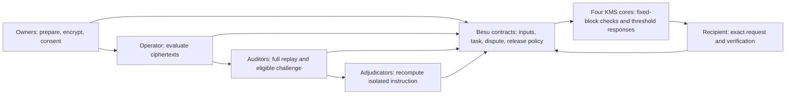

# Roles and execution

Data owners provide inputs and authorize their use. An operator computes over
the encrypted inputs. A recipient receives an accepted output only after the
release conditions are met. Validators maintain the chain. KMS participants
perform distributed key setup and recipient-bound output release.

## Linear path

Owners authenticate their contributions with signatures and commitments. Record
admission checks those contributions before aggregate acceptance. The operator
aggregates the encrypted records and their authentication data. Result checking
uses the admitted aggregate. Owners and the recipient also check the public
conversion used by the current grouped-radix threshold profile. The contract
does not prove that off-chain conversion.

## Nonlinear path

`compliance-circuit.mjs` defines explicit input, output and constant references.
The executor follows those references under its pinned canonical FHE profile.
An authenticated trace commits to the intermediate results. An auditor replays
the public ciphertext computation. A mismatch can trigger a bonded challenge,
bisection and an authenticated leaf opening. Adjudicators independently recompute
the isolated public operation and certify its digest. The contract authenticates
the certificate and settles the dispute without decrypting the intermediate value.

Canonical validity is ciphertext-byte equality under the selected execution
profile. Equal plaintext values in different ciphertexts need not be canonical.
Cross-platform byte agreement is checked before distributed measurements. This
check must not be bypassed when moving to another processor or build.

The current default nonlinear path uses `bounty-v2`. The older canonical and
simulated component routes remain for explicit regression work. Their costs and
trust assumptions must not be mixed with the threshold campaign.

## Decision and release

Final acceptance or dispute settlement determines the task outcome. Bond release
and reward withdrawal are subsequent bookkeeping operations. They are reported
separately from time to the final decision. Output authorization is also a
separate step: all contributing owners approve the exact recipient-bound request
after finality. The on-chain policy consumes a one-use slot and updates cumulative
owner-bound record counters atomically.

Each KMS core derives the authorization fields from the request and checks the
same reservation block/hash through four validators. At least three canonical
responses must agree. The relayer cannot authorize a release by itself. Recipient
response thresholds, validator consensus and adjudicator certificates have
different roles and are not interchangeable.

## Deployment boundaries

Local execution puts logical roles on one Docker host. The default cloud layout
uses four geographic protocol hosts. Each hosts one validator, one KMS participant
and one owner under common administration, plus assigned computation roles. An
optional fifth administrative VM controls execution and stores evidence. It is
not another validator or KMS participant. See [topology](../distributed/README.md).

Role isolation and authenticated transport are implementation properties. The
example's single administrator does not supply evidence of independent trust
domains or resilience to host/provider failures. The experimental parameter
choice is described under [parameter scope](EXPERIMENTS.md#parameter-scope).

## Follow a request through the implementation

[Protocol flows](PROTOCOLS.md) gives preparation, the two computation paths,
challenge branches and the exact output-release sequence.
[Incentives](INCENTIVES.md) explains deposited funds and the conditional payoff
arguments. The [evidence map](EVIDENCE.md) relates these rules to model theorems,
contract regressions and retained measurements.

The arrows summarize messages and dependencies, not trust equivalence. Besu
validators, FHE/KMS participants and adjudicators are different committees.
The administrative cloud controller orchestrates the experiment; it is not an
additional member of any protocol quorum. Its duties and the measured recipient
verification scope are distinguished in [protocols](PROTOCOLS.md).

## Source entry points

| Component | Inspect first |
| --- | --- |
| Local orchestration and isolation | `threshold-kms/campaign/run.py`, `container.py`, `Dockerfile` |
| Linear authentication | `BN254-Signatures/contract/MKLHS-Verification-v3.sol` |
| Explicit nonlinear circuit and canonical replay | `fhe-pod/scripts/compliance-circuit.mjs`, `canonical-protocol.mjs` |
| Audit commitments, funds and task decisions | `fhe-pod/contracts/src/CanonicalBountyFHEDisputeGame.sol` |
| Authenticated disclosure | `fhe-pod/contracts/src/BountyTraceAvailability.sol` |
| Instruction certificates | `fhe-pod/contracts/src/CanonicalLeafVerifier.sol` |
| Owner-approved irreversible reservations | `threshold-kms/contracts/OnChainReleasePolicy.sol` |
| Per-core request guard and recipient binding | `threshold-kms/src/onchain_release.rs`, `recipient_validation.rs` |
| Geographic transport and role placement | `distributed/topology.py`, `runtime.py`, `worker.mjs` |
| Evidence validation and derivation | `threshold-kms/campaign/onchain_evidence.py`, `bounty_evidence.py`; `threshold-kms/postprocess/` |

A contract certificate verifies authenticated signer statements, not FHE
arithmetic inside the EVM. Authorization restricts final-output release, not
public ciphertext evaluation. Ciphertext-byte canonicality is relative to an
admitted profile, not a portability guarantee across arbitrary hardware/libraries.
