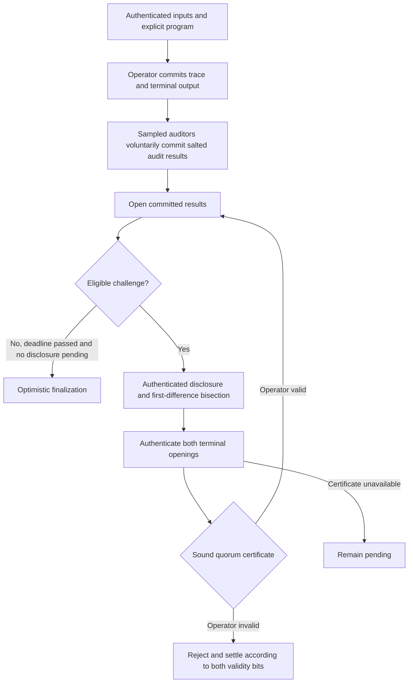

# Protocol execution and failure boundaries

Start with [roles and topology](ARCHITECTURE.md). This page follows the current
threshold campaign and bounty-v2 nonlinear path. Component and legacy demos do
not inherit these rules. The [evidence map](EVIDENCE.md) separates model theorems,
implementation checks and measurements.

## Shared preparation and trust boundaries

1. Establish four Besu QBFT validators, participant identities and one release
   policy lineage. Register stable owner-bound record identifiers and budgets.
   A new task/key context does not reset spent counters.
2. Four KMS participants perform PRSS, preprocessing and DKG. The public key and
   evaluation material are distributed; private shares remain with their cores.
3. Owners prepare admitted, well-typed dataset records and encrypt with private
   randomness. Signed records, digests and provenance bind inputs to the program,
   execution profile and key context. Input truth and ciphertext validity are
   owner/preparation assumptions, not established by a signature alone.
4. Freeze the program and execution configuration. The nonlinear relation is
   byte equality to the deterministic evaluator on authenticated ciphertext
   operands. It is not merely equality of decrypted values.

The public evaluation uses Test parameters and public research inputs for the
[functional PoC](EXPERIMENTS.md#parameter-scope).
A deployment with separate containers or geographic hosts is not evidence of
independent administration. No raw plaintext, full FHE secret or decryption
service is supplied to the auditor/adjudicator as part of the audit path.

## Linear aggregation and delivery

Owners sign commitments bound to the registered operation, input count, index,
key/profile context and their identity. Record admission verifies authorization
and accumulates the signed weighted commitments. The operator aggregates the
ciphertext coordinates and submits an aggregate commitment. Contract equality
binds this commitment to admitted inputs; the contract does not receive and
recompute the complete ciphertext vector.

The delivered vector requires an independent digest/commitment check. For the
current grouped-radix profile, input preparation uses eight base-four blocks,
at most four records per group, and separate positive/negative subtotals. Public
carry propagation and admitted bounds make the conversion to the KMS ciphertext
well-defined. Owners and the recipient have conversion-verification duties; the
KMS guard also recomputes conversion from authenticated inputs. The linear
contract alone does not prove this transformation. The older single-LWE proof
and measurements must not be substituted for the grouped conversion.

Implementation: [MKLHS-Verification-v3.sol](../BN254-Signatures/contract/MKLHS-Verification-v3.sol),
[GroupedLinearVerification.sol](../threshold-kms/contracts/GroupedLinearVerification.sol),
[compatible_fhe.rs](../threshold-kms/src/compatible_fhe.rs) and
[linear_release.rs](../threshold-kms/src/linear_release.rs).

## Nonlinear trace, audit and dispute

The diagram omits explicit timer/funding guards; the contracts enforce them.
Reopening after a lost challenge bars that author for the task and preserves
opportunities for other eligible auditors. Accepted computation proceeds to
output authorization; rejected computation cannot authorize its invalid output.

- The [circuit compiler](../fhe-pod/scripts/compliance-circuit.mjs) fixes explicit
  input/output/constant dependencies before seeing encrypted values. The canonical
  executor commits a power-of-two trace with authenticated operand references.
  Padding preserves the computation. Arbitrary application semantics are not
  inferred from matching clear values.
- [Canonical replay](../fhe-pod/scripts/canonical-protocol.mjs) recomputes the full
  execution and finds the first divergence, without knowing an injected fault's
  location. The first mismatch has matching predecessors, hence matching operands.
- The salted commitment binds chain, contract, task, auditor, leaf index, result,
  evidence and candidate root. Anyone may relay its exact opening; the beneficiary
  cannot be changed by a relay. Every sampled task auditor is eligible across
  leaves, but no reward forces one to perform replay.
- A disclosure request blocks unqualified optimistic acceptance. Authenticated
  publication checks trace/program/provenance roots for each batch. Unauthenticated
  or poisoned prefixes do not satisfy availability. Timely requests during the
  commitment phase preserve a full new replay/commitment interval after disclosure.
- Bisection uses authenticated branches. Relays can act for both sides. At the
  terminal step both openings must authenticate before faults are attributed.
  Invalid caller calldata is not itself evidence that the operator cheated.
- Adjudicators recompute the isolated instruction on ciphertexts. The
  [leaf verifier](../fhe-pod/contracts/src/CanonicalLeafVerifier.sol) authenticates
  a quorum certificate; Solidity does not perform the FHE operation. A valid
  operator result defeats the challenge. Operator-invalid/challenger-valid alone
  earns the computational bounty. Both-invalid rejects without a bounty.

Full replay costs linear work in trace length. Only localization uses logarithmic
bisection rounds; authenticated trace disclosure and input-membership proofs are
additional work. Read [incentives and settlement](INCENTIVES.md) for every financial
branch, default and conditional progress argument.

## Admitted instruction semantics

The [micro-ISA definition](../fhe-pod/scripts/micro-isa.mjs) assigns stable codes
1–15. Operands/results are unsigned 64-bit values, subject to explicit bounds:

| Operations | Meaning / additional guards |
| --- | --- |
| `MUL` (1), `ADD` (6) | Product/sum must fit uint64 |
| `SHR` (2) | Public shift count below 64 |
| `CAST_U8` (3) | Retain the low eight bits |
| `MIN` (4) | Minimum of two admitted operands |
| `BITAND` (5), `BITOR` (13), `BITXOR` (14) | Bitwise operations |
| `SUB` (7) | Left operand at least right operand; no unsigned underflow |
| `DIV` (8), `MOD` (9) | Nonzero public divisor |
| `EQ` (10), `LT` (11), `GT` (12) | Boolean result encoded as 0 or 1 |
| `ADD_CHAIN` (15) | Between one and eight public increments of one; no overflow; not an arbitrary array sum |

`SHR`, `DIV`, `MOD` and `ADD_CHAIN` have public control operands. Public interval
admission must establish required ranges before encrypted execution. Clear-value
reference evaluation and legacy FHEVM helpers are separate from current canonical
certificate adjudication. The current game verifies signatures on recomputed
ciphertext results; it does not invoke a legacy FHEVM leaf-decryption path.

## Final-output authorization and recovery

1. Every contributing owner consents to the statement: chain/policy, task/program,
   execution/key context, ordered inputs, records, output type, recipient and slot.
2. After path-specific finality and required output/conversion checks, the
   recipient signs the exact release request and every contributing owner
   separately approves it. A changed ciphertext, recipient key or wire request
   does not inherit an earlier approval.
3. [OnChainReleasePolicy.sol](../threshold-kms/contracts/OnChainReleasePolicy.sol)
   checks finality, owner approvals, the recipient signature, an unused request
   key/slot and cumulative per-record budgets. Reservation consumes identifiers
   and charges counters atomically. Approval flags cannot be revoked.
4. Each KMS core derives fields from the **received** request, checks the pinned
   chain/policy and exact reservation at one fixed block height/hash supported
   by three of four configured validator responses, checks workflow/output binding,
   and consumes its durable request marker before MPC participation.
5. The designated recipient combines the required encrypted threshold responses
   and checks them. Public evaluation, copying ciphertexts and use/redistribution
   of authorized plaintext are not prevented by this release policy.

See [onchain_release.rs](../threshold-kms/src/onchain_release.rs),
[kms-request-adapter.mjs](../threshold-kms/scripts/kms-request-adapter.mjs),
[workflow-auth.mjs](../threshold-kms/campaign/workflow-auth.mjs) and
[recipient_validation.rs](../threshold-kms/src/recipient_validation.rs).
The selected observation block need not be the block that created the reservation.
A failure after reservation can consume budget without delivering a result.
No-reuse and authorization safety are distinct from guaranteed delivery.

The general quorum premise is `f < q <= n-f`, with distinct authenticated
responders, honest responses to the same fixed finalized state and eventual
participation for progress. The configured validator query threshold (3/4),
recipient response threshold (3/4) and adjudicator threshold (2/3) serve different
purposes. None replaces Besu's own consensus assumptions.

## Proof-of-concept verification duties

The specification requires independent recipient delivery/conversion checks.
In the measured PoC, owners and the coordinator performed grouped conversion or
nonlinear trace/output checks; the recipient hashed the ciphertext, signed the
request and checked threshold responses. The KMS guard has its separate workflow
and conversion duties. Do not describe the observed recipient as having performed
all independently specified checks or infer independent trust domains from those
coordinator checks. The [proof mapping](../formal/SOURCE_CORRESPONDENCE.md) records
`Release.OutputBound` separately from on-chain approval.
